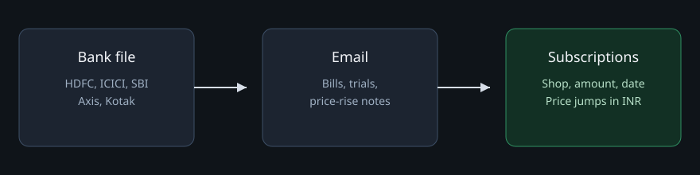
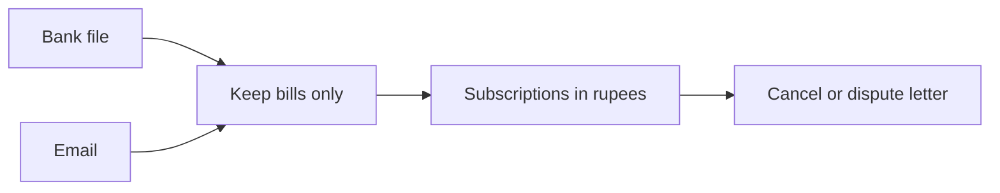

# LeakLock MCP 🚀

LeakLock is a local MCP server for India. It reads your bank export and your billing mail, then shows the subscriptions that keep charging you. Chat apps such as Cursor, Claude, and ChatGPT can call it. Your balance and full account number stay on your computer.





## What you can ask

After the server is connected, talk normally:

- Import `statements/hdfc.csv`. The bank is HDFC.
- What am I paying every month?
- Did any price go up?
- Write a cancel letter for Airtel.

You get the shop, the amount, and the next likely date. A letter is saved as a file. LeakLock does not send it.

## Install

You need Python 3.12 or newer.

```bash
git clone https://github.com/Akshay-Anand010/leaklock-mcp.git
cd leaklock-mcp/server
python -m venv .venv
source .venv/bin/activate
pip install -e ".[dev]"
python -m pytest
```

On Windows, activate the venv with `.venv\Scripts\activate`.

Start it yourself with:

```bash
python -m leaklock.server
```

The chat app usually starts this command for you. You do not keep a terminal open.

## Connect it to chat

Use the full path to `server` on your machine. The database and the secret file are created in that folder.

### Cursor

Put this in `.cursor/mcp.json` in the project, or in Cursor Settings under MCP:

```json
{
  "mcpServers": {
    "leaklock": {
      "command": "python",
      "args": ["-m", "leaklock.server"],
      "cwd": "/absolute/path/to/leaklock-mcp/server"
    }
  }
}
```

If the venv Python is not the default `python`, set `command` to the full path of `.venv/bin/python`.

### Claude Desktop

Add the same `mcpServers` block to `claude_desktop_config.json`.

- macOS: `~/Library/Application Support/Claude/claude_desktop_config.json`
- Windows: `%APPDATA%\Claude\claude_desktop_config.json`

Restart Claude after saving.

### Any other MCP app

The server speaks standard MCP over stdio. Point the app at:

```text
python -m leaklock.server
```

Run that command with `server` as the working directory.

## Indian bank files

Pass `bank_template_hint` as one of `hdfc`, `icici`, `sbi`, `axis`, or `kotak`.

Those files use day/month/year. `05/06/2026` is 5 June 2026. Amounts can start with `₹` or `Rs`. The default currency is INR.

| Line | What LeakLock does |
| --- | --- |
| `UPI/NETFLIX` or `UPI-AIRTEL` | Keeps it as a bill |
| `UPI/RAHUL SHARMA` | Drops it. That is a person, not a subscription |
| PhonePe, GPay, Paytm, IMPS, or NEFT to a person | Drops it |
| Balance, salary credit, grocery | Drops it |

CSV, Excel (`.xlsx`), and Quicken/OFX (`.qfx`) are accepted. A generic CSV with ISO dates works when you leave the bank hint empty.

## Email

The mail tool takes a provider name, `gmail` or `imap`, and how many days to look back. It does not take a password. Passwords live in `server/leaklock.secrets.json`, which git ignores.

Saved mail already on disk:

```json
{
  "eml_dir": "/absolute/path/to/bills"
}
```

Gmail over IMAP, using a Google app password:

```json
{
  "gmail": {
    "host": "imap.gmail.com",
    "username": "you@gmail.com",
    "password": "your-app-password"
  }
}
```

Another mailbox:

```json
{
  "imap": {
    "host": "imap.example.com",
    "username": "you@example.com",
    "password": "your-password"
  }
}
```

Only billing mail, trial-ending notes, and price-rise notes are kept. The message body is not stored.

## Tools

| Tool | What it does |
| --- | --- |
| `ingest_financial_statement` | Reads one statement and returns a short summary |
| `sync_billing_communications` | Reads billing mail from the local secret file |
| `analyze_leakage_and_hikes` | Finds repeating charges and price jumps |
| `generate_advocacy_action` | Writes a cancel or dispute letter on disk |

`generate_advocacy_action` takes `action_type` of `cancel` or `dispute_hike`. The chat sees the shop, amount, and dates. A stored account number can be written into the letter file. It is not returned to the chat.

## Resources

| Address | What it returns |
| --- | --- |
| `leaklock://descriptors` | Bank text and the readable shop name |
| `leaklock://ledger/subscriptions` | Every subscription |
| `leaklock://ledger/subscriptions/{id}` | One subscription |

These read a local SQLite file, `server/leaklock.db`. An unknown id returns an empty body.

## What stays on your computer

LeakLock does not upload your statement. The summary sent back to chat is the file name, how many rows were kept, shop names, and the date span. Account balances and full account numbers are removed before that.

## Tests

```bash
cd server
python -m pytest
```
